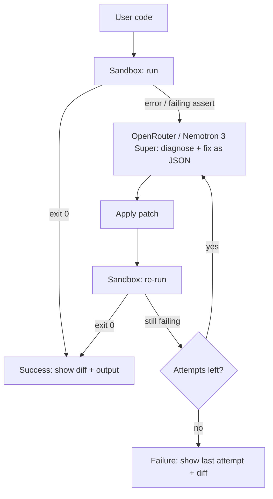

# PatchPilot

An autonomous AI agent that runs buggy Python, reads the failure, asks an LLM for a fix, applies it, and repeats until the code passes.

**Live demo:** https://\<app-name\>.streamlit.app

> Demo only. Not production software. Do not paste sensitive code.

## What it does

Paste buggy Python (or pick a built-in sample). PatchPilot runs it, captures the error or failing assertion, gets a diagnosis and corrected program from NVIDIA Nemotron 3 Super (via OpenRouter), re-runs the patched code, and loops up to 4 attempts. The UI streams every step live and finishes with a side-by-side view, a unified diff, and the final run output.

## Architecture



## Features

- Live attempt log with error, diagnosis, and patched code per attempt
- Final badge, original vs fixed, unified diff, final output
- 4 built-in buggy samples
- Replay mode: with no API key, samples replay pre-recorded fixes so the demo never looks broken
- Guardrails: 5 repair runs per session, 200-line input cap, 10s run timeout

## Tech stack

Python 3.11+, Streamlit, OpenAI Python SDK pointed at [OpenRouter](https://openrouter.ai), model NVIDIA Nemotron 3 Super (`nvidia/nemotron-3-super-120b-a12b`).

## Project structure

```
app.py                  Streamlit UI
patchpilot/
  agent.py              repair loop, yields step events (max 4 attempts)
  sandbox.py            subprocess runner (temp dir, 10s timeout, stripped env)
  llm.py                OpenRouter call, strict-JSON prompt, defensive parsing
  samples.py            sample programs + recorded fixes for replay mode
.streamlit/
  config.toml           theme/server config
  secrets.toml.example  secrets template (real secrets.toml is gitignored)
requirements.txt
```

## Local setup

```bash
git clone https://github.com/le-Affan/patch-pilot.git
cd patch-pilot
python -m venv .venv && source .venv/bin/activate
pip install -r requirements.txt
```

### API key

Either create `.streamlit/secrets.toml` (gitignored):

```toml
OPENROUTER_API_KEY = "sk-or-v1-your-key-here"
PATCHPILOT_MODEL = "nvidia/nemotron-3-super-120b-a12b"  # optional, this is the default
```

or export env vars:

```bash
export OPENROUTER_API_KEY=sk-or-v1-your-key-here
export PATCHPILOT_MODEL=nvidia/nemotron-3-super-120b-a12b   # optional, this is the default
```

Run:

```bash
streamlit run app.py
```

Without a key the app starts in replay mode (samples only).

## How it works

**Agent loop** (`agent.py`): run the code. If exit code is 0, done. Otherwise send the code, the run output, and a summary of earlier failed attempts to the LLM, (Nemotron 3 Super through OpenRouter's OpenAI-compatible API, no provider-specific JSON mode), which must return `{"diagnosis", "fixed_code"}`. Run the new code. Repeat until it passes or the attempt limit (1-4, set in sidebar) is hit. Each step is yielded as an event so the UI renders progressively. LLM, network, or parse errors end the loop gracefully and are shown in the log. The prompt tells the model to fix the code, never the tests.

**Sandbox** (`sandbox.py`): writes code to a fresh temp dir and runs `python -I main.py` in a subprocess with a 10s timeout, no stdin, truncated output, and a minimal environment (`PATH`, `HOME`, `TMPDIR` only), so API keys and other secrets are not inherited.

**LLM parsing** (`llm.py`): strips `<think>` blocks, accepts raw JSON, JSON inside markdown fences, or JSON embedded in prose; falls back to a bare code fence.

## Sample bugs

1. Off-by-one: `range(len(nums) + 1)` raises `IndexError`
2. `KeyError`: incrementing a missing dict key
3. Wrong recursion base case: `factorial(0)` recurses forever
4. Failing assert test: case-sensitive palindrome check

## Limitations

- Demo only; Python only; single-file programs, standard library only
- **Not a secure sandbox.** A subprocess with a timeout does not block filesystem or network access, or resource abuse. Do not expose publicly with untrusted traffic beyond a throwaway demo
- Passing means exit code 0; the agent does not verify semantic correctness beyond what the code's own asserts check
- Session caps reset on page refresh

## Future work

- Real isolation (containers, gVisor, or a hosted sandbox API), memory/CPU limits, network off
- Multi-file projects and dependency installation
- Run user-supplied test files separately from source
- Streaming LLM tokens, cost tracking, other languages

## License

MIT
